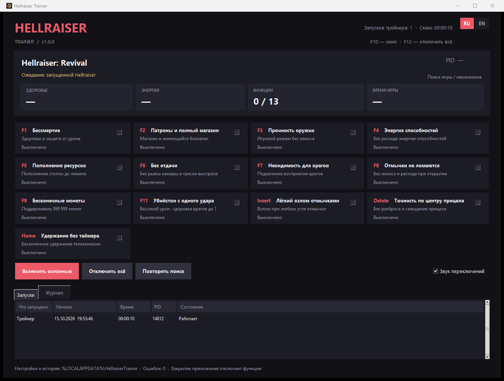
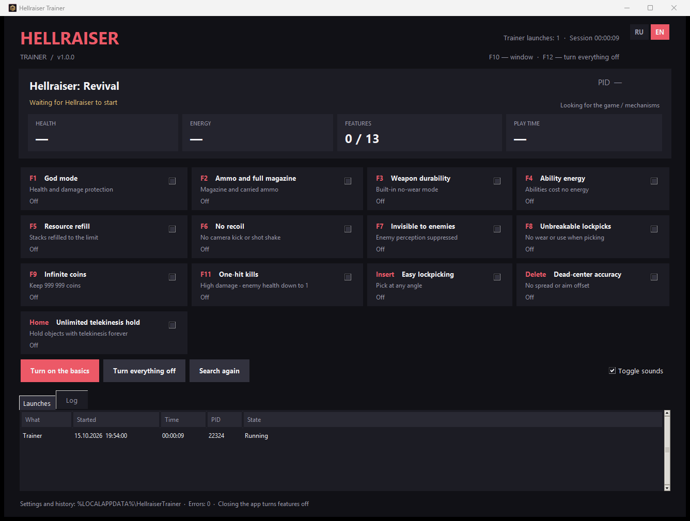

# Hellraiser Trainer

**Русский** · [English](#english)

Трейнер для **Clive Barker's Hellraiser: Revival** (Unreal Engine 5, Windows x64). 13 функций на горячих клавишах,
статус каждой функции прямо в окне, журнал запусков. Интерфейс на русском и английском.



## Как пользоваться

1. Скачайте `HellraiserTrainer.exe` из [Releases](https://github.com/jestelf/HellraiserTrainer/releases/latest).
2. Запустите игру и трейнер в любом порядке — трейнер найдёт игру сам. Права администратора не нужны, Python не нужен.
3. Включайте функции флажками или горячими клавишами. Клавиши работают, когда активно окно игры или трейнера.
4. Язык интерфейса — кнопки **RU / EN** в правом верхнем углу, переключение мгновенное.

| Клавиша | Функция |
|---|---|
| F1 | Бессмертие |
| F2 | Патроны и полный магазин |
| F3 | Прочность оружия |
| F4 | Энергия способностей |
| F5 | Пополнение ресурсов |
| F6 | Без отдачи |
| F7 | Невидимость для врагов |
| F8 | Отмычки не ломаются |
| F9 | Бесконечные монеты |
| F11 | Убийство с одного удара |
| Insert | Лёгкий взлом отмычками |
| Delete | Точность по центру прицела |
| Home | Удержание телекинезом без таймера |
| F10 / F12 | Показать окно / выключить всё |

Цвет статуса под функцией: зелёный — работает, жёлтый — частично или ожидание (нужно оружие, замок, враги), красный — в этой версии игры механизм не найден.

При закрытии трейнер возвращает всё, что менял: флаги, параметры врагов, константы Blueprint. Монеты и пополненные предметы остаются.
Настройки и история хранятся в `%LOCALAPPDATA%\HellraiserTrainer`.

## Версии игры

Трейнер не привязан к адресам одной сборки: при подключении он находит таблицы имён и объектов Unreal Engine в памяти игры,
проверяет их структуру и дальше работает с игровыми объектами по именам свойств. Если структура не распознана, запись в память отключается.

**Проверка.** В игре (сборка `A91530FF`, вся кампания до эпилога) проверялись ранние версии трейнера. Версия 1.0 использует ту же
логику работы с игрой, к ней добавлены автоматический поиск таблиц движка, двуязычный интерфейс и хранение настроек в профиле
пользователя; в самой игре версия 1.0 отдельно не проверялась. На других сборках большинство функций работает через имена свойств;
невидимость, игровой тег неуязвимости и формула износа отмычек могут работать частично — это будет видно по жёлтому статусу.

## Антивирусы

Трейнер читает и пишет память процесса игры, а exe собран PyInstaller и не подписан — из-за этого часть антивирусов может предупредить о файле.

* Весь исходный код — в этом репозитории. Сетевых запросов, автозапуска, доступа к файлам браузеров нет.
* Трейнер работает только с процессом `Hellraiser-Win64-Shipping.exe`, не внедряет код, не останавливает и не перезапускает игру.
* Exe можно собрать самому (см. «Сборка»). Контрольная сумма SHA-256 указана в описании выпуска.

## Сборка

Нужен Python 3.10+ и PyInstaller (`pip install pyinstaller`):

```
powershell -ExecutionPolicy Bypass -File build.ps1
```

Без сборки: `python src\app.py`.

## Лицензия

[MIT](LICENSE). Только для одиночной игры. Проект не связан с разработчиками и издателями игры.

---

<a id="english"></a>

# Hellraiser Trainer

[Русский](#hellraiser-trainer) · **English**

A trainer for **Clive Barker's Hellraiser: Revival** (Unreal Engine 5, Windows x64). 13 hotkey features, a live status for each
feature and a launch log. The interface is available in English and Russian.



## Usage

1. Download `HellraiserTrainer.exe` from [Releases](https://github.com/jestelf/HellraiserTrainer/releases/latest).
2. Start the game and the trainer in any order — the trainer finds the game by itself. No administrator rights or Python needed.
3. Use the checkboxes or hotkeys. Hotkeys work while the game or the trainer window is active.
4. Switch the interface language with the **RU / EN** buttons in the top-right corner; it changes instantly.

| Key | Feature |
|---|---|
| F1 | God mode |
| F2 | Ammo and full magazine |
| F3 | Weapon durability |
| F4 | Ability energy |
| F5 | Resource refill |
| F6 | No recoil |
| F7 | Invisible to enemies |
| F8 | Unbreakable lockpicks |
| F9 | Infinite coins |
| F11 | One-hit kills |
| Insert | Easy lockpicking |
| Delete | Dead-center accuracy |
| Home | Unlimited telekinesis hold |
| F10 / F12 | Show window / turn everything off |

Status color under each feature: green — working, yellow — partial or waiting (needs a weapon, a lock, enemies), red — the mechanism was not found in this game version.

On exit the trainer restores everything it changed: flags, enemy values, Blueprint constants. Coins and refilled items stay.
Settings and history are kept in `%LOCALAPPDATA%\HellraiserTrainer`.

## Game versions

The trainer is not tied to one build's addresses: on connect it finds the Unreal Engine name and object tables in the game's memory,
validates their structure and then works with game objects by property name. If the structure is not recognized, memory writes are disabled.

**Testing.** Earlier versions of the trainer were tested in the game (build `A91530FF`, the whole campaign up to the epilogue).
Version 1.0 uses the same game logic, adding automatic engine table discovery, the bilingual interface and per-user settings;
version 1.0 itself was not tested in the game separately. On other builds most features work through property names; invisibility,
the game's invulnerability tag and the lockpick wear formula may work partially, which the yellow status shows.

## Antivirus warnings

The trainer reads and writes the game process memory, and the exe is built with PyInstaller and unsigned, so some antivirus software may warn about it.

* The full source code is in this repository. No network access, autostart or browser data access.
* The trainer only touches `Hellraiser-Win64-Shipping.exe`; it does not inject code, suspend or restart the game.
* You can build the exe yourself (see "Building"). The SHA-256 checksum is listed in the release notes.

## Building

Requires Python 3.10+ and PyInstaller (`pip install pyinstaller`):

```
powershell -ExecutionPolicy Bypass -File build.ps1
```

Without building: `python src\app.py`.

## License

[MIT](LICENSE). Single-player only. Not affiliated with the game's developers or publishers.
